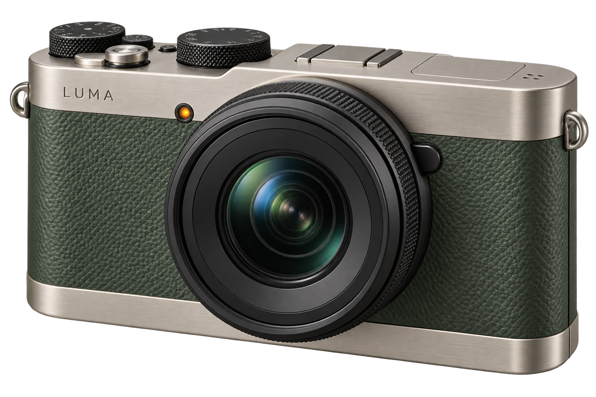

# Landing Page Collection ✦

> **Bộ sưu tập trang giới thiệu sản phẩm cao cấp với nghệ thuật kể chuyện thị giác (Visual Storytelling) đỉnh cao qua hiệu ứng cuộn đa tầng Parallax mượt mà 60fps. Mẫu tiêu biểu Luma Field kết nối vẻ đẹp thiên nhiên hoang sơ với thiết kế máy ảnh du lịch tinh xảo, tích hợp trình điều khiển màu sắc tương tác, cuộn quán tính Lenis và chuẩn tiếp cận người dùng toàn diện.**

**Dự án của Toàn Nguyễn** · Thiết kế & Phát triển trải nghiệm tương tác Web (Creative Frontend)

[Xem tính năng](#features) · [Tài liệu kỹ thuật & cài đặt](TECHNICAL.md)

[Nghiên cứu phong cách web, thuật ngữ và 3 task triển khai độc lập](docs/research/creative-web/README.md)

  

_Hình sản phẩm ý tưởng Luma Field, được tạo bằng AI; đây là tài nguyên minh họa của trang giới thiệu._

---

## 🌟 Trải Nghiệm Trực Tuyến (Live Website)

- **Trang chủ danh mục (Catalog):** [https://nhttoan0809.github.io/landingpage-parallax](https://nhttoan0809.github.io/landingpage-parallax)
- **Mẫu sản phẩm Luma Field:** [https://nhttoan0809.github.io/landingpage-parallax/luma/](https://nhttoan0809.github.io/landingpage-parallax/luma/)

---

## 📌 Executive Summary (Tổng quan dự án)

| Thông số               | Chi tiết                                                                       |
| :--------------------- | :----------------------------------------------------------------------------- |
| **Project Name**       | **Landing Page Collection**                                                    |
| **Project Type**       | Bộ sưu tập landing page nghệ thuật, ứng dụng chuyển động và thị giác phong phú |
| **Đối tượng sử dụng**  | Khách hàng cao cấp, người yêu công nghệ/nhiếp ảnh và các nhà phát triển web    |
| **Phạm vi phát triển** | Thiết kế concept, hiệu ứng chuyển động đa tầng, âm hưởng thị giác và tối ưu UX |
| **Trạng thái**         | Hoàn thiện trang danh mục và sản phẩm mẫu máy ảnh du lịch ý tưởng Luma Field   |

---

## 🎯 Problem & Solution (Bài toán & Giải pháp)

- **Problem:** Đa số các trang landing page thương mại điện tử hiện nay đi theo khuôn mẫu tĩnh đơn điệu, thiếu cảm xúc và không truyền tải được linh hồn hay câu chuyện phía sau sản phẩm, dẫn đến tỉ lệ thoát trang cao và mức độ gắn kết thấp.
- **Solution:** Thiết kế trải nghiệm cuộn điện ảnh (Cinematic Scroll) đưa người xem qua một hành trình khám phá tuần tự: từ phong cảnh thiên nhiên rộng mở, các góc cắt cấu tạo máy ảnh, bộ ảnh chụp thực địa sống động đến cấu hình phiên bản màu sắc theo sở thích. Tất cả được điều phối nhịp nhàng bằng Framer Motion và thuật toán cuộn mượt Lenis.

---

## ✨ Key Features (Tính năng nổi bật)

| Mẫu                | Điểm đáng khám phá                                                                                                             |
| :----------------- | :----------------------------------------------------------------------------------------------------------------------------- |
| **Trang danh mục** | Giao diện tối giản mang phong cách editorial, điều hướng mượt mà đến từng mẫu sản phẩm chuyên biệt                             |
| **Luma Field**     | Hành trình thị giác khép kín từ phong cảnh thiên nhiên, chi tiết thiết kế máy ảnh, bộ sưu tập hình ảnh và tùy chọn cấu hình máy |

Với **Luma Field**, người xem có thể:

- Khám phá các lớp phong cảnh và sản phẩm chuyển động theo thao tác cuộn.
- Chuyển giữa ba cảm hứng hình ảnh bằng chuột hoặc bàn phím.
- Chọn màu máy và tải bản tóm tắt cấu hình để lưu lại.
- Theo dõi nội dung với trải nghiệm có xét tùy chọn giảm chuyển động.

_Sản phẩm, thông số và giá của Luma Field là hư cấu. Trải nghiệm lựa chọn bộ máy không tạo đơn hàng hay phát sinh thanh toán._

---

## 👨‍💻 Competencies & Contributions (Năng lực & Đóng góp)

- **Tư duy hình ảnh:** Kết nối bố cục, màu sắc, hình ảnh và nội dung theo tinh thần sản phẩm.
- **Kể chuyện qua tương tác:** Dùng chuyển động để dẫn dắt việc khám phá, kết hợp với các thao tác chọn và lưu cấu hình.
- **Chú ý khả năng tiếp cận:** Xem xét thao tác bàn phím và nhu cầu giảm chuyển động.
- **Tổ chức sản phẩm:** Xây dựng bộ sưu tập có thể bổ sung những mẫu mang bản sắc khác nhau.

---

## 📈 Future Roadmap (Hướng phát triển)

- [ ] Bổ sung mẫu giới thiệu sản phẩm cho các lĩnh vực khác.
- [ ] Mở rộng bộ sưu tập với những bản sắc và cách tương tác riêng.

---

## 👤 Author & Contact

- **Tác giả:** Toàn Nguyễn
- **GitHub:** [@nhttoan0809](https://github.com/nhttoan0809)
- **Tài khoản sinh viên (cùng tác giả):** [@toanb1805926](https://github.com/toanb1805926)

---

## 📄 License

Xem [thông tin giấy phép và tài nguyên bên thứ ba](TECHNICAL.md#license).
