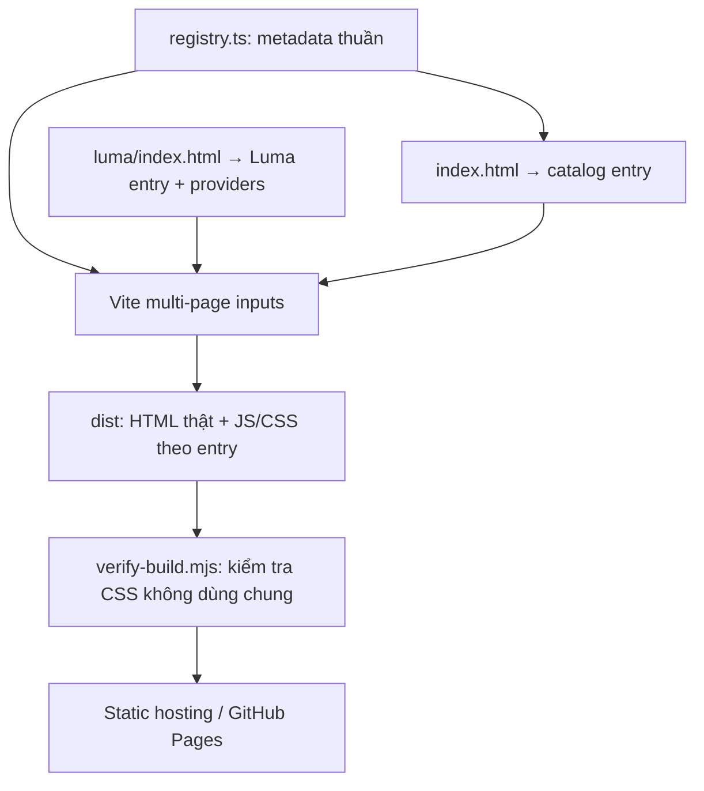

# Technical Guide · Landing Page Collection

[Tổng quan dự án và năng lực thể hiện](README.md)

Tài liệu dành cho lập trình viên và agents. Các lệnh chạy từ thư mục gốc repo; đọc [AGENTS.md](AGENTS.md) trước khi thay đổi collection và [Luma AGENTS.md](src/landings/luma/AGENTS.md) trước khi thay đổi trải nghiệm Luma.

[Phạm vi](#scope) · [Skills & Tech Stack](#stack) · [Kiến trúc & API](#architecture) · [Cài đặt](#setup) · [Điểm kỹ thuật](#highlights) · [Hướng cải thiện](#roadmap) · [Tham khảo](#references) · [Giấy phép](#license)

<a id="scope"></a>

## 📍 Implementation Scope (Phạm vi triển khai)

Repo là một collection MPA, gồm catalog tại `/` và Luma tại `/luma/`. Luma giới thiệu máy ảnh du lịch ý tưởng với parallax, gallery tab hỗ trợ bàn phím, chọn màu và tải cấu hình TXT local. Không có API backend, database, checkout hoặc gửi đơn hàng.

Luma khởi tạo Lenis và HelmetProvider trong entry riêng; `MotionConfig reducedMotion="user"` kết hợp nhánh giá trị tĩnh cho parallax khi người dùng yêu cầu giảm chuyển động. Catalog không khởi tạo Lenis hoặc nạp provider của Luma.

---

<a id="stack"></a>

## 🛠 Skills & Tech Stack (Kỹ năng & Công nghệ)

| Nhóm                   | Công nghệ                                                      | Vai trò trong triển khai                                                     |
| :--------------------- | :------------------------------------------------------------- | :--------------------------------------------------------------------------- |
| **UI**                 | React 19, TypeScript 5.8                                       | Catalog và các landing độc lập                                               |
| **Build**              | Vite 7, Bun                                                    | Multi-page build theo registry và lockfile                                   |
| **Styling**            | CSS riêng theo tài liệu, CSS Modules cho catalog, Autoprefixer | Giữ reset, token và style của từng trang độc lập                             |
| **Animation của Luma** | Framer Motion 12, Lenis                                        | Motion values theo cuộn và một vòng RAF cho smooth scroll                    |
| **Metadata của Luma**  | React Helmet Async                                             | Title và mô tả trang; metadata/font/favicon còn được khai báo tại HTML riêng |
| **Testing**            | Vitest 3, Testing Library, jsdom                               | Catalog links, câu chuyện sản phẩm, gallery, dialog, menu và reduced motion  |
| **Code Quality**       | ESLint 9, Prettier 3                                           | Kiểm tra mã và định dạng                                                     |
| **CI / Hosting**       | GitHub Actions, GitHub Pages                                   | Lint, test, build theo base path và publish toàn bộ `dist/`                  |

Tailwind CSS 3.4 còn trong dependencies nhưng không được bật toàn cục. PostCSS chỉ chạy Autoprefixer. Mẫu mới cần tự thiết lập pipeline Tailwind trong phạm vi riêng nếu sử dụng. `package.json` chưa khóa phiên bản Node/Bun; dùng runtime tương thích dependencies hiện tại.

Kỹ năng triển khai thể hiện ở: lifecycle và cleanup animation; keyboard accessibility; reduced motion; tách tài nguyên theo entry; kiểm tra build manifest. Hướng dẫn chọn **skills cho agents** nằm tại [docs/frontend-skills.md](docs/frontend-skills.md); đó là tài liệu hỗ trợ phát triển, không phải dependency runtime.

---

<a id="architecture"></a>

## 🏗 System Architecture & API Design (Kiến trúc & Thiết kế API)



### Vì sao CSS độc lập?

Repo sử dụng **Vite multi-page app (MPA)**, không ghép tất cả mẫu vào một SPA.
Mỗi URL là một tài liệu HTML riêng, với entry JavaScript, stylesheet, reset,
font, favicon và provider riêng. Chuyển giữa các mẫu bằng liên kết HTML thông
thường sẽ tạo tài liệu mới; CSS của trang trước không còn trong trang sau.

Trang danh mục chỉ import **metadata** và ảnh preview. Nó không import component,
CSS, font hay Lenis của Luma. CSS Modules dùng cho component của danh mục; mỗi
landing tự quản lý hệ thống style. Các selector như `body`, `:root`, `.button`
trong Luma chỉ tác động đến tài liệu Luma.

Vite tách CSS theo entry. Bước build chạy `scripts/verify-build.mjs` để duyệt
manifest và báo lỗi nếu bất kỳ stylesheet nào được dùng chung giữa hai tài liệu.
Thư viện JavaScript nền tảng như React vẫn có thể được Vite dùng chung để tận dụng
cache; điều đó không tạo ra theme hay stylesheet dùng chung.

Tailwind hiện được giữ trong dependencies nhưng không bật toàn cục. Không có
preflight hoặc theme chung; trang mới muốn dùng Tailwind phải thiết lập riêng
trong phạm vi trang đó. CSS hiện tại được xử lý bằng Autoprefixer.

### Cấu trúc repository

```text
index.html                       # Tài liệu danh mục tại /
luma/index.html                  # Tài liệu Luma tại /luma/
src/
  catalog/                       # Entry, giao diện, CSS, tests của danh mục
  landings/
    registry.ts                  # Metadata và danh sách entry cho Vite
    luma/
      main.tsx                   # Mount React và provider riêng
      App.tsx
      index.css                  # Reset, token, CSS chỉ của Luma
      components/
      sections/
      lib/
      content/
      __tests__/
      AGENTS.md
  setupTests.ts                  # Hạ tầng kiểm thử
public/
  catalog.svg
  landings/luma/                 # Images và favicon của Luma
docs/
  strategy.md                    # Kiến trúc collection
  landings/luma/                 # Thiết kế, nguồn ảnh, prompt ảnh sản phẩm
scripts/verify-build.mjs          # Kiểm tra các tài liệu không dùng chung CSS
```

### URL và tài nguyên

| Môi trường       | Catalog                  | Luma                          |
| :--------------- | :----------------------- | :---------------------------- |
| **Development**  | `/`                      | `/luma/`                      |
| **GitHub Pages** | `/landingpage-parallax/` | `/landingpage-parallax/luma/` |

Dùng `${import.meta.env.BASE_URL}${slug}/` cho liên kết giữa tài liệu và `#section` cho anchor nội bộ. Tài nguyên Luma dùng `${import.meta.env.BASE_URL}landings/luma/...`; HTML dùng `%BASE_URL%`. Mỗi landing có HTML, CSS, font, favicon và provider riêng; không tạo root App gom các mẫu vào cùng SPA.

---

<a id="setup"></a>

## 🚀 Getting Started (Cài đặt & Chạy thử)

Cần Bun và trình duyệt hiện đại. Không cần `.env`, API key hoặc database cho các trang hiện có. Internet được dùng để tải dependencies và font bên ngoài; ảnh được lưu trong `public/`.

```bash
git clone https://github.com/nhttoan0809/landingpage-parallax.git
cd landingpage-parallax
bun install --frozen-lockfile
bun run dev
```

Mở `http://localhost:5173/` để xem catalog, `http://localhost:5173/luma/` để xem Luma. Nếu cổng bận, dùng cổng Vite in trên terminal. Dev/preview chuyển `/luma` thành `/luma/`; giữ dấu `/` cuối trong liên kết.

```bash
bun run build
bun run preview
```

Build nằm trong `dist/`; preview thường dùng `http://localhost:4173/`. Không chạy script publish khi chỉ cần xem local.

---

<a id="highlights"></a>

## 🔍 Implementation Highlights (Điểm kỹ thuật & Module)

<a id="extension"></a>

### Thêm landing page mới

Ví dụ tạo mẫu thương hiệu `orbit`:

1. Tạo `orbit/index.html`, khai báo metadata và font riêng. Entry script:
   `<script type="module" src="/src/landings/orbit/main.tsx"></script>`.
2. Tạo `src/landings/orbit/` chứa entry, component, reset, token, CSS và tests riêng.
   Provider/animation chỉ khởi tạo từ entry của Orbit.
3. Đặt tài nguyên vào `public/landings/orbit/`. Trong TSX dùng
   `${import.meta.env.BASE_URL}landings/orbit/...`; trong HTML dùng `%BASE_URL%`.
4. Thêm metadata vào `src/landings/registry.ts` với `slug: "orbit"`, tên,
   mô tả, phong cách và ảnh preview. Trang chủ tự liệt kê và Vite tự đưa
   `orbit/index.html` vào build.
5. Cập nhật bảng danh mục trong README và chạy đầy đủ kiểm tra.

Không import CSS hoặc component của các mẫu khác để tái sử dụng giao diện.
Tham khảo [AGENTS.md](AGENTS.md) cho quy tắc kỹ thuật đầy đủ.

<a id="verification"></a>

### Kiểm tra và xác nhận

```bash
bun run lint
bun run test --run
bun run build
```

- `build` chạy TypeScript, Vite và `scripts/verify-build.mjs`; guard theo cả static/dynamic import trong manifest để phát hiện CSS dùng chung giữa HTML entries.
- Test catalog kiểm tra liên kết từ registry và base path. Test Luma kiểm tra nội dung, tab bằng bàn phím, màu được chuyển vào dialog, menu di động và parallax tĩnh khi bật reduced motion.
- Sau thay đổi giao diện/hành vi: kiểm tra mobile/desktop, focus dialog, tải file cấu hình, cuộn, ảnh, reduced motion và lỗi trình duyệt.
- Sau thay đổi entry/path/asset: kiểm tra truy cập trực tiếp, reload, hash, catalog → landing → catalog và browser back. Kiểm tra build/preview với base GitHub Pages theo phần dưới.
- Giữ `cssCodeSplit: true`; không tắt build guard, thêm stylesheet chung hay nạp animation provider ở catalog.

Các lệnh tùy chọn đã khai báo: `bun run format` kiểm tra định dạng; `bun run test:coverage` xuất báo cáo coverage. Không suy ra FPS/Lighthouse từ việc build hoặc unit test pass.

<a id="deployment"></a>

### Triển khai GitHub Pages

```bash
VITE_GITHUB_PAGES=true bun run build
VITE_GITHUB_PAGES=true bun run preview
```

Với tên repo hiện tại, các đường dẫn public là:

- Danh mục: `/landingpage-parallax/`
- Luma: `/landingpage-parallax/luma/`

Workflow `.github/workflows/deploy.yml` build và upload toàn bộ `dist/`, gồm
`dist/index.html` và `dist/luma/index.html`. Các URL con có file HTML thật nên
hỗ trợ mở trực tiếp và refresh mà không cần SPA rewrite hay trang 404 chuyển hướng.
Nếu đổi tên repo, sửa `repositoryBase` trong `vite.config.ts` và `homepage`
trong `package.json`.

Địa chỉ khai báo trong `package.json`: `https://nhttoan0809.github.io/landingpage-parallax`. Trạng thái online cần kiểm tra riêng; lệnh build/preview không publish trang.

---

<a id="roadmap"></a>

## 📈 Learnings & Technical Roadmap (Bài học & Hướng cải thiện)

### Bài học rút ra

- Tách mỗi landing thành một tài liệu giúp cô lập CSS, font và vòng đời animation.
- Dùng registry metadata cho cả catalog và build inputs giúp quản lý danh sách trang tại một nguồn.
- Build guard và kiểm thử tương tác xác nhận các khía cạnh khác nhau; không thay thế việc quan sát hành vi trên trình duyệt.

### Hướng cải thiện đề xuất

- [ ] Khóa phiên bản runtime để tăng khả năng tái lập môi trường.
- [ ] Mở rộng kiểm tra trực tiếp URL, CSS isolation và asset khi có thêm landing.
- [ ] Bổ sung kiểm thử trình duyệt cho cuộn, dialog và file tải xuống.

---

<a id="references"></a>

## 📚 References (Tài liệu liên quan)

[Định hướng Luma, nguồn ảnh](docs/landings/luma/design.md) ·
[Prompt ảnh máy ảnh](docs/landings/luma/camera-image-prompt.txt) ·
[Skills frontend](docs/frontend-skills.md)

Ảnh máy ảnh được tạo bằng ImageGen; ảnh thiên nhiên từ Unsplash để minh họa.
Mỗi mẫu mới được tự chọn ngôn ngữ hình ảnh và cách tương tác phù hợp.

- [Collection strategy](docs/strategy.md): ranh giới entry, CSS và build registry.
- [Registry các landing](src/landings/registry.ts): metadata catalog và nguồn build inputs.
- [Quy tắc repository cho agents](AGENTS.md), [quy tắc Luma](src/landings/luma/AGENTS.md).

---

<a id="license"></a>

## 📄 License

Repo chưa có file `LICENSE` cấp gốc xác định giấy phép cho toàn bộ ứng dụng. Skill vendored và thư viện bên thứ ba có thể có giấy phép riêng; không suy ra giấy phép toàn repo từ các thành phần đó. Nguồn ảnh và prompt sản phẩm được ghi trong tài liệu thiết kế Luma.
